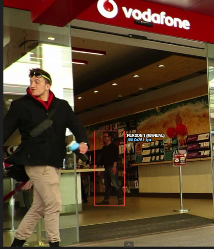
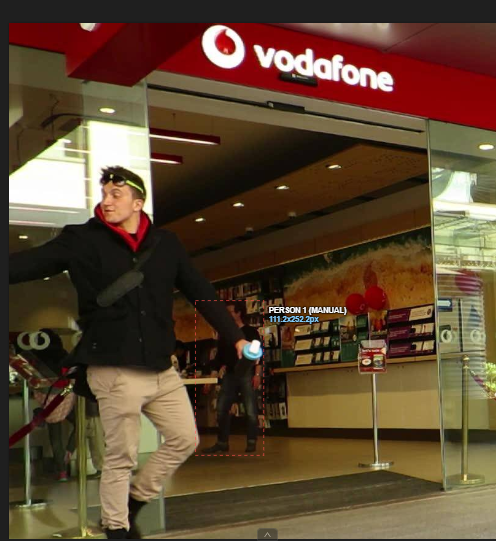
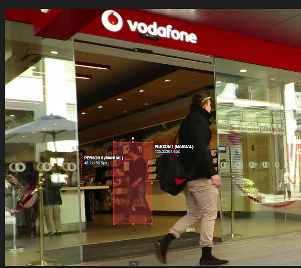

# Báo cáo cá nhân — BuiVanThinh-2A202604040

Đoạn video: MOT17-09, 150 frame (frame 1–150), nguồn MOTChallenge, giấy phép CC BY-NC-SA 3.0.

## 0. Thông tin học viên

- Họ tên: Bùi Văn Thịnh
- MSSV: 2A202604040
- Mã đề (A/B/C): A (ID gốc MOT17-09: 1, 7, 19, 20, 21)
- Email: buivanthinhtxt@gmail.com
- Link repository: https://github.com/buivanthinhtxt-del/K5-L2B-DAY05-BUI-VAN-THINH-2A202604040-MOTTracking
- Giờ bắt đầu: 16:13, 13/11/2026 (GMT+7)
- Giờ kết thúc: 18:29, 13/11/2026 (GMT+7), xuất file lần cuối

## 1. Xem trước đoạn video (CP0)

Số frame theo CVAT (0–149).

| Mã | Frame xuất hiện | Frame cuối thấy được | Rẽ / dừng / đổi tốc độ ở frame | Bị che ở frame | Ghi chú |
|---|---|---|---|---|---|
| P1 | 0 | 149 | Đi sang phải trong cửa hàng 0–89; dừng khoảng 89–112; sau đó quay nhẹ sang trái và lại gần camera 112–149 | Che một phần 25–55 (người áo khoác đen, quần kaki đi ngang), mất hẳn 42–43; che một phần 99–111 | Áo len đen, quần jean, bên trong cửa hàng Vodafone. Người dùng cho bài che khuất CP2 |
| P2 | 32 | 149 | Đi từ trái sang phải sau tấm kính 32–99; chậm lại 99–119; quay sang trái và lại gần camera 119–149 | Che một phần 32–98 (kính có logo, quầy), mất hẳn 33–37 và 41 (người quần kaki đi ngang); che một phần 100–101 | Phụ nữ áo trắng-cam, quần đen, tóc dài |
| P3 | 0 | 149 | Đi sang trái và tiến về phía camera suốt đoạn; box to dần (cao 344 → 842 px); đổi tốc độ quanh 120–125 | Không bị che | Phụ nữ áo khoác xanh lá, đeo túi |
| P4 | 0 | 149 | Đi vào từ mép phải, sang trái và tiến về phía camera; box to dần (cao 190 → 953 px) | 0–66 bị mép phải khung hình cắt | Ông lớn tuổi áo xanh dương, đội mũ |
| P5 | 0 | 146 | Di chuyển rất ít, gần như đứng yên từ khoảng frame 40 | Che một phần 105–110, 135–146; mất hẳn 111–134 (P3 đi ngang) và 147–149 (P4 đi ngang) | Em bé mặc đồ vàng/xanh, trước bảng quảng cáo Woolworths |

## 2. Keyframe và thời gian (CP1, CP4)

Số keyframe lấy từ kết quả `src/check_submission.py`.

| Mã | Số keyframe | Keyframe ở frame | Số frame có mặt | Keyframe / 100 frame | Thời gian (phút) | Chỗ khó |
|---|---|---|---|---|---|---|
| P1 | 55 | 0, 4, 6, 14–16, 18–26, 28–30, 32–34, 39, 40, 44, 46, 48–50, 54, 56, 59, 69, 73, 79, 89, 91, 93–95, 99–103, 105, 107, 109, 110, 112, 113, 119, 129, 139, 146, 149 | 148 | 37.2 | | Người quần kaki đi ngang che P1 (25–55); P1 dừng rồi đổi hướng (89–113) |
| P2 | 37 | 32, 38–40, 42–60, 64, 69, 79, 89–91, 99, 100, 102, 109, 119, 129, 139, 149 | 112 | 33.0 | | Đi sau tấm kính, chỉ thấy phần trên người, phải ước lượng box toàn thân (38–60) |
| P3 | 20 | 0, 10, 20, 30, 40, 50, 60, 70, 80, 90, 100, 110, 120, 122, 124, 125, 130, 140, 144, 149 | 150 | 13.3 | | Box to nhanh khi lại gần camera (cuối đoạn) |
| P4 | 20 | 0, 10, 20, 30, 40, 50, 59, 60, 67–70, 80, 90, 100, 110, 120, 130, 140, 149 | 150 | 13.3 | | Bị mép khung hình cắt lúc đi vào (0–66) |
| P5 | 18 | 0, 10, 20, 30, 40, 50, 60, 100, 105, 107, 109, 110, 135, 137, 139, 140, 143, 145 | 123 | 14.6 | | Box nhỏ; bị P3 rồi P4 đi ngang che |
| **Tổng** | **150** | | **683** | **22.0** | | |

Keyframe / 100 frame của cả bài = tổng keyframe ÷ tổng số frame có mặt × 100 = 150 ÷ 683 × 100 = **22.0**

Bạn đặt keyframe nhiều nhất ở người nào? Vì sao (người đó rẽ, dừng, lại gần camera hay bị che)?

Nhiều nhất ở **P1 (55 keyframe, 37.2 / 100 frame)**. Từ frame 15 đến 56, người mặc áo khoác đen, quần kaki đi ngang ngay trước P1. Tay, chai nước và thân người này che P1 từng phần, nên phải đặt keyframe gần như từng frame để giữ box toàn thân đúng vị trí và đúng cờ. Đoạn 89–113, P1 dừng lại rồi đổi hướng, nội suy tuyến tính bị lệch nên phải thêm keyframe. **P2 (37 keyframe)** đứng thứ hai, vì ở frame 38–60 cô ấy đi sau tấm kính có logo, chỉ thấy phần trên người, nên mỗi frame phải ước lượng lại box toàn thân. Ba người còn lại đi khá đều (13–15 keyframe / 100 frame), nằm trong mức tham khảo 8–18 của lớp.

## 3. Đoạn bị che (CP2)

Người bị che: `P1`

| Mốc | Frame |
|---|---:|
| Bắt đầu bị che một phần (bật `occluded`) | 25 |
| Mất hẳn (bật `outside`) | 42 |
| Hiện lại (tắt `outside`) | 44 |
| Thấy rõ trở lại (tắt `occluded`) | 56 |

- Thời gian khuất hẳn: 2 frame (42–43) = 0,07 giây (30 fps).
- Quyết định: **giữ cùng ID**.
- Lý do (trả lời 3 câu: khuất bao lâu so với 60 frame, ngoại hình có khớp, chỗ hiện lại có đúng hướng và tốc độ):

1. Khuất hẳn 2 frame, rất xa ngưỡng 60 frame (2 giây) của lớp.
2. Ngoại hình khớp: cùng áo len đen, quần jean, cùng dáng và kích thước.
3. Hiện lại đúng hướng và tốc độ cũ. Box ở frame 40 là x = 307–432; box khi hiện lại ở frame 44 là x = 321–449. P1 vẫn đi sang phải với tốc độ như trước khi bị che.

Các đoạn che khác trong job (cũng giữ cùng ID, ghi lại để giải thích các chỗ track bị đứt):

| Người | Đoạn `outside` | Độ dài | Lý do giữ ID |
|---|---|---|---|
| P2 | 33–37 và 41 | 5 frame và 1 frame | Đứng sau kính, bị người quần kaki đi ngang che hoàn toàn; hiện lại đúng chỗ, cùng ngoại hình |
| P5 | 111–134 | 24 frame = 0,8 giây | P3 đi ngang trước em bé; em bé gần như đứng yên nên hiện lại đúng vị trí cũ |
| P5 | 147–149 | đến hết đoạn | P4 đi ngang che đến frame cuối |

Ảnh chụp màn hình (nguồn ảnh: MOT17, MOTChallenge (Milan et al., 2016)):





## 4. Tự review ID (CP3)

Lượt 1 theo người (đi ngược từ frame 149 về 0 trên CVAT), lượt 2 theo cảnh (nhảy 10 frame). Ít nhất 3 dòng; không có lỗi thì ghi một dòng "đã kiểm hai lượt, không lỗi".

Loại lỗi dùng đúng một trong 7 mã: `id_switch`, `fragmentation`, `lost`, `merge`, `false_track`, `drift`, `flag`.

| Frame | Mã người | Loại lỗi | Mô tả một câu | Phát hiện ở lượt | Đã sửa? |
|---:|---|---|---|---|---|
| 38–59 | P2 | | Box chỉ bao phần thân nhìn thấy sau kính, không bao toàn thân | | Sửa một phần (đã kéo dài box) |
| 15–34 | P1 | | Cờ occluded bật tắt xen kẽ từng frame | | Đã sửa |
| 0–5 | P1 | | Cờ occluded bật dù P1 không bị che | | Chưa |
| 39 | P1 | | P1 bị che kín nhưng cờ occluded tắt | | Chưa |

Tổng hợp số lỗi theo loại:

| `id_switch` | `fragmentation` | `lost` | `merge` | `false_track` | `drift` | `flag` |
|---:|---:|---:|---:|---:|---:|---:|
| | | | | | | |

Lỗi nào chỉ lượt 2 (theo cảnh) mới thấy, lượt 1 (theo người) không thấy? Vì sao?

...

## 5. File xuất và kết quả tự kiểm (CP4)

| Kiểm tra | Kết quả |
|---|---|
| Tên file MOT 1.1 | `src/exports/BuiVanThinh_mot.zip` |
| Tên file CVAT for video 1.1 | `src/exports/BuiVanThinh_cvat_video.zip` |
| Số track ID khác nhau trong `gt/gt.txt` (phải là 5) | 5 |
| Frame `outside` không có dòng trong `gt.txt` (đúng / sai) | Đúng (đã kiểm: P1 frame 42–43, P2 frame 33–37 và 41, P5 frame 111–134 đều không có dòng) |
| Job đã completed trên CVAT máy cá nhân | |

Ghi chú: ID trong `gt.txt` được CVAT đánh số lại theo thứ tự tạo track: ID 1 = P1, ID 2 = P3, ID 3 = P4, ID 4 = P5, ID 5 = P2.

Dán phần tóm tắt in ra từ `src/check_submission.py`:

```text
Số frame in theo CVAT (bắt đầu từ 0). Trong gt.txt, frame_id = frame CVAT + 1.

=== File MOT 1.1: BuiVanThinh_mot.zip ===
  Số track ID: 5   |   Tổng số box: 683
  [OK]        Đúng 5 track ID.

  Track | Frame có mặt | Số frame | Đoạn vắng (outside)
      1 |   0–149      |      148 | 42–43
      2 |   0–149      |      150 | -
      3 |   0–149      |      150 | -
      4 |   0–146      |      123 | 111–134
      5 |  32–149      |      112 | 33–37, 41


=== File CVAT for video 1.1: BuiVanThinh_cvat_video.zip ===

  Track | Nhãn   | Frame thấy | Keyframe | KF/100 frame | Frame occluded | Lần bật outside
      0 | person |        148 |       55 |         37.2 |             47 |               1
              Track 0: keyframe ở frame [0, 4, 6, 14, 15, 16, 18, 19, 20, 21, 22, 23, 24, 25, 26, 28, 29, 30, 32, 33, 34, 39, 40, 44, 46, 48, 49, 50, 54, 56, 59, 69, 73, 79, 89, 91, 93, 94, 95, 99, 100, 101, 102, 103, 105, 107, 109, 110, 112, 113, 119, 129, 139, 146, 149]
      1 | person |        150 |       20 |         13.3 |              0 |               0
              Track 1: keyframe ở frame [0, 10, 20, 30, 40, 50, 60, 70, 80, 90, 100, 110, 120, 122, 124, 125, 130, 140, 144, 149]
      2 | person |        150 |       20 |         13.3 |             67 |               0
              Track 2: keyframe ở frame [0, 10, 20, 30, 40, 50, 59, 60, 67, 68, 69, 70, 80, 90, 100, 110, 120, 130, 140, 149]
      3 | person |        123 |       18 |         14.6 |             10 |               2
              Track 3: keyframe ở frame [0, 10, 20, 30, 40, 50, 60, 100, 105, 107, 109, 110, 135, 137, 139, 140, 143, 145]
      4 | person |        112 |       37 |         33.0 |             63 |               2
              Track 4: keyframe ở frame [32, 38, 39, 40, 42, 43, 44, 45, 46, 47, 48, 49, 50, 51, 52, 53, 54, 55, 56, 57, 58, 59, 60, 64, 69, 79, 89, 90, 91, 99, 100, 102, 109, 119, 129, 139, 149]

  Tổng: 150 keyframe / 683 frame có mặt = 22.0 keyframe / 100 frame
  [OK]        Đọc được 5 track từ annotations.xml.

=== Tóm tắt ===
  Lỗi: 0   |   Cảnh báo: 0
  Đạt. Dán phần tóm tắt này vào báo cáo mục 5.
```

## 6. Ba câu kết

1. Nếu được gán lại, bạn sẽ đặt keyframe khác ở đâu? Vì sao?

   ...

2. Có chỗ nào bạn không chắc "cùng ID hay ID mới"? Bạn đã quyết định và ghi chú thế nào?

   ...

3. Một lỗi ID trong job của bạn (nếu không còn sót, chọn lỗi đã sửa) có thể làm xe tự lái dự đoán sai chuyển động của người đó như thế nào? Lỗi đó ảnh hưởng MOTA hay IDF1 nhiều hơn?

   ...

## Bonus (nếu làm)

Không làm.

## 7. Tài liệu tham khảo và công cụ AI đã dùng

- Dữ liệu: MOT17-09, MOTChallenge (Milan et al., 2016), giấy phép CC BY-NC-SA 3.0.
- Tài liệu lab: `docs/GUIDELINE.md`, `docs/MOT_FORMAT.md`, `docs/CVAT_CHEATSHEET.md`, `CHECKPOINTS.md`, `RUBRIC.md`.
- Công cụ AI: Claude Code (Anthropic). Dùng để:
  - hỏi cách dùng CVAT (Track mode, cờ `occluded` / `outside`, xuất file);
  - chạy `src/check_submission.py` và giải thích kết quả, giải thích lỗi PowerShell khi chạy sai thư mục;
  - vẽ box từ file xuất lên frame để soát lỗi, từ đó phát hiện box P2 ở frame 38–59 bị co theo phần nhìn thấy, và cờ `occluded` của P1 bị thừa hoặc thiếu ở một số frame; các lỗi này tôi tự sửa tay trên CVAT;
  - soạn khung câu chữ cho các mục 0–3, 5, 7 từ số liệu trong file xuất.
- Không dùng AI hay tracker tự động để sinh box hoặc track ID. Mục 4 và mục 6 do tôi tự viết.
